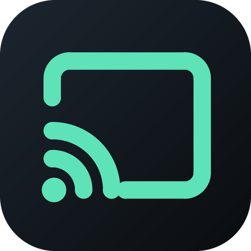
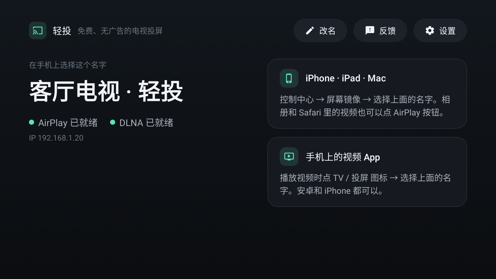
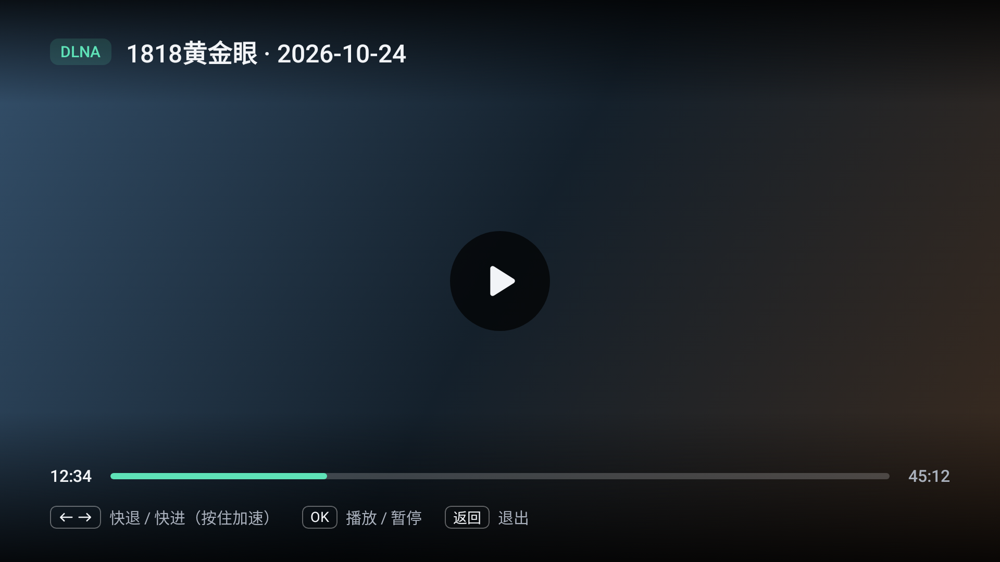
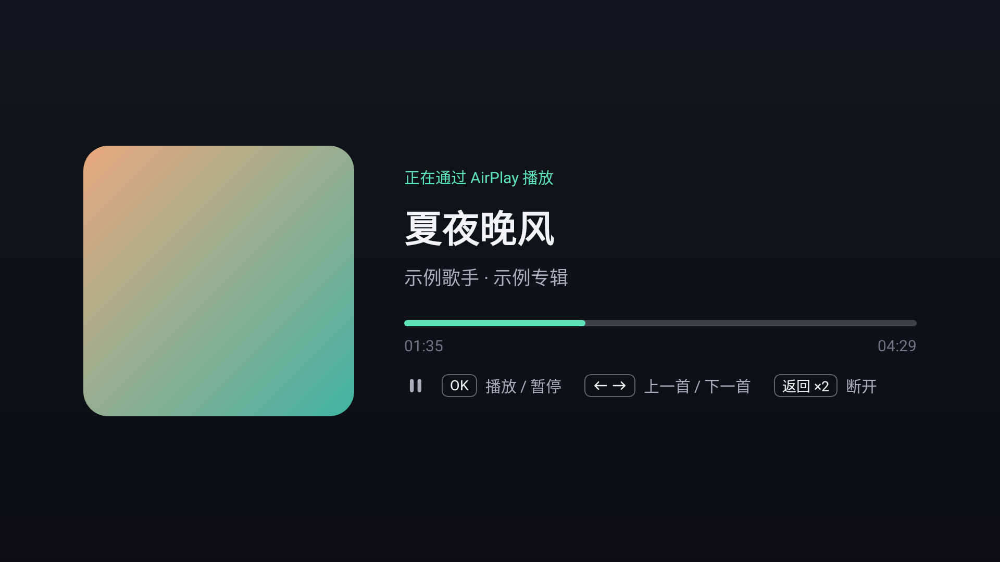

<div align="center">



# LiteCast (轻投)

**Free, ad-free casting for Android TVs.** Install it on the TV and cast from an iPhone or an Android phone.

[Download APK](https://github.com/Jaqennn/LiteCast/releases/latest/download/LiteCast.apk) · [Install](#install) · [Undo](#undo) · [FAQ](#faq) · [中文说明](README.md)

</div>

| Home | Video | AirPlay music |
|---|---|---|
|  |  |  |

## Why

- **The TV's built-in casting wants money**: Chinese-market Sony TVs and others ship with Lebo (乐播), which starts asking for a membership. LiteCast began on a Sony X90J like that.
- **iPhones can't cast to most Android TVs**: screen mirroring only speaks AirPlay.
- **Switching apps doesn't last**: many third-party casting apps want accounts, show ads or cap the time; some are free when installed, then update themselves into a paid plan that allows ten minutes per cast.
- **The usual workarounds don't stick**: uninstalling Lebo's updates or restoring an old version often comes undone with the next system update.

## What LiteCast gives you

- Free, no ads, no account, no time limit; open source
- No membership can appear later: casting stays on your home Wi-Fi, and LiteCast has no server and no account
- iPhone and Android phones alike: AirPlay (mirroring, video, music) and DLNA (the cast button in video apps) run side by side
- Old TVs too: Android 5.0 and later, on TVs, boxes and projectors
- Install once: it waits in the background, starts with the TV, pops up when you cast and closes when you stop
- Leaves the TV alone: no system settings are changed, it runs next to Lebo (if Lebo holds the port, LiteCast picks another one by itself), and uninstalling undoes everything
- One APK, under 10 MB, for every TV, 32- and 64-bit

## What can be cast

| From | How | Works |
|---|---|---|
| iPhone / iPad / Mac: screen mirroring | Control Center → Screen Mirroring → "TV name · 轻投" | ✅ Picture and sound |
| iPhone / iPad / Mac: AirPlay video | The AirPlay button in Photos, Safari and AirPlay apps | ✅ The TV streams it; the phone can sleep |
| iPhone / iPad / Mac: AirPlay music | Apple Music and other music apps | ✅ Cover, title and progress |
| Any phone: the TV / cast button in video apps (DLNA) | Bilibili, iQiyi, Tencent Video, Youku, live-streaming apps and more | ✅ Mostly |
| Android phones: system screen mirroring (Miracast) | | ❌ Needs system-level Wi-Fi Direct |
| Huawei Cast+, Xiaomi and other vendor casting, Lebo cloud cast, Google Cast | | ❌ Closed or certified protocols |
| DRM content (Netflix, Disney+, the Apple TV app) | | ❌ Only certified receivers; mirroring shows black |

The app decides the quality: DLNA only hands the TV a URL (Bilibili gives third-party receivers 720p at most, Douyin 1080p).

## Supported TVs

- Android 5.0 or later: Android TV / Google TV, Android-based TVs from any brand, boxes and projectors
- Common brands: Sony Android TV / Google TV (X90J, A90J, X90L and others); TVs from TCL, Xiaomi, Skyworth and Sharp, projectors from Dangbei and XGIMI, and boxes such as the Xiaomi box mostly run Android-based systems: if the TV can install third-party apps, it can install LiteCast
- ARM chips (nearly every TV)
- Not supported: Android 4.4 and older; non-Android systems such as Samsung Tizen and LG webOS; old TVs that cannot install apps at all. Huawei and Honor smart screens have not been tried
- How to tell: Settings → About shows an Android version, or the TV can install third-party app stores

Tested: Sony X90J (Chinese market, Android 12; the system reports the model as BRAVIA 4K VH2), the author's own TV, on 0.2.1 — mirroring, AirPlay video and music and DLNA all work (Douyin casts at 1080p), alongside Lebo. Android 5.0–5.1 has not been tried on a real TV yet. Please [report your TV](https://github.com/Jaqennn/LiteCast/issues/new?template=device.yml), working or not.

## Download

[Download LiteCast.apk](https://github.com/Jaqennn/LiteCast/releases/latest/download/LiteCast.apk). On the [release page](https://github.com/Jaqennn/LiteCast/releases/latest) it is the **LiteCast.apk** file under "Assets"; the "Source code" entries are the source, not the app.

If GitHub doesn't open or the download crawls (common in mainland China), try mobile data or another Wi-Fi; use the mirror on Lanzou, [https://wwary.lanzoub.com/b01i5zvujg](https://wwary.lanzoub.com/b01i5zvujg) (code `47il`), which holds the same LiteCast.apk uploaded from the release page (GitHub always has the newest); or let an AI agent install it (below), which falls back to a download mirror and checks the file against the official SHA-256.

## Install

- **USB drive** (no computer, no developer mode, no coding): copy LiteCast.apk to a USB drive and open it with the TV's file manager. If the TV refuses apps from unknown sources, allow that file manager in Settings → Device Preferences → Security & restrictions → Unknown sources (the place differs between brands). On Chinese-market Sony TVs it is simpler: plug in the drive, press 主菜单 (Home) on the remote, open 我的应用 (My Apps) at the top left and start 应用助手 (App Assistant); it lists 轻投 from the drive, then choose 安装 (Install). Sony's 媒体播放器 (Media Player) only shows photos, videos and music, so an empty drive there is normal. If a file manager doesn't show the APK, some TVs hide installers there: open the drive with the TV's own app manager instead.
- **An AI agent**: give a desktop agent that can run commands (Claude Code, Codex, …) the guide in [docs/agent.md](docs/agent.md) (in Chinese) and your TV's IP address; it installs, checks and reports back.
- **adb**:
  ```bash
  adb connect <TV IP>:5555
  adb install -r LiteCast.apk
  adb shell appops set io.github.litecast SYSTEM_ALERT_WINDOW allow   # not needed on Android 5.x
  adb shell am start -n io.github.litecast/io.github.litecast.tv.HomeActivity
  ```

**Updating**: install the new LiteCast.apk the same way; it replaces the old version and keeps the settings. If the TV says the app wasn't installed, an early test build from before 0.2.0 (signed with a different key) is still there: uninstall it first.

Open LiteCast once. For casts to pop up while you are watching something else, allow **Display over other apps** (the home screen has a button for it). From then on it waits in the background and starts with the TV.

## Remote

- Video: ←/→ seek (hold to accelerate), OK play/pause, ↑/↓ show progress, Back hide bar / exit
- Mirroring: Back twice disconnects
- Music: OK play/pause, ←/→ previous/next, Back twice disconnects

## Undo

LiteCast changes no system settings and disables nothing, so uninstalling restores the TV: in the app list select LiteCast (轻投), hold the OK button and choose Uninstall (on Chinese-market Sony TVs: 主菜单 → 我的应用 → 轻投 → hold OK → 卸载); or Settings → Apps → LiteCast → Uninstall; or `adb uninstall io.github.litecast`.

## Compared with other options

| Option | Good | Not so good |
|---|---|---|
| Pay for Lebo's membership | No fiddling | You keep paying |
| Uninstall Lebo's updates, restore an old version | Nothing new to install | Often undone by the next system update |
| Other free casting apps | Install and go | Some want accounts, show ads or cap the time; some turned paid later |
| A TV box or Apple TV | Reliable | Costs money and takes an HDMI port |
| An HDMI cable to a computer or phone | Best picture, no latency | A cable across the room |
| LiteCast | Free and open source, iPhone and Android, runs next to Lebo | No full-screen mirroring from Android phones; you install an APK |

## FAQ

- **The phone doesn't list the TV**: phone and TV must be on the same network (guest networks and AP isolation block discovery); turn off the phone's VPN; on an iPhone, allow Local Network for the video app. On a TV with Lebo it can take a few seconds to appear.
- **A cast doesn't show up**: allow Display over other apps, or open LiteCast first.
- **YouTube keeps loading**: with AirPlay video the TV downloads from YouTube itself, so the TV's network has to reach it; screen mirroring works regardless.
- **Mirroring stutters**: use 5 GHz Wi-Fi for the phone and Ethernet for the TV, or lower the resolution in Settings → Advanced.
- **Will it start charging one day?** There is nothing to charge for: no server, no account, casting stays on your network. The code is GPL-3.0, so anyone can carry it on.
- **Do I have to open LiteCast before every cast?** No. It starts with the TV and waits in the background; with Display over other apps allowed, a cast pops up over whatever you are watching.
- **Can I cast while the TV is in standby?** Not yet; turn the TV on first.
- **Android's own "wireless display", or Huawei / Xiaomi / Samsung casting, can't find LiteCast**: those are Miracast or vendor protocols that need system-level access on the TV. On Android phones, use the cast button inside video apps.
- **Is the picture compressed?** Mirroring sends the phone's screen as live video, a little softer than an HDMI cable; with a video app's cast button the TV plays the original stream, at the quality the app allows.
- **4K and HDR?** If the app hands over a 4K stream and the TV can decode it, it plays in 4K; HDR depends on the video and the TV. For mirroring, 1080p is recommended.
- **Gaming?** Mirroring has a little latency: fine for video and photos, not for fast games. The frame-rate cap (60 by default) is in Settings → Advanced.
- **Playback speed, portrait videos?** Speed control isn't there yet. Portrait videos keep black bars on a landscape TV.
- **One app's casts drop after a while, or it doesn't list LiteCast**: some apps only cast to their own TV apps or block third-party receivers. Try mirroring, and tell us which app.
- **Security**: no account, no data collected. LiteCast only asks for network and local discovery, start at boot, display over other apps (to pop up a cast), a foreground service with its notification (to wait in the background) and keeping the screen on while casting; no storage, camera, microphone, contacts or location. Casting protocols have no password (AirPlay can require a PIN in settings), so use it on your home network only.
- **Feedback**: the Feedback button on LiteCast's home screen shows a survey QR code (in Chinese) with your TV's brand, model and Android version beside it; on GitHub, [report your TV](https://github.com/Jaqennn/LiteCast/issues/new?template=device.yml) or [a problem](https://github.com/Jaqennn/LiteCast/issues/new?template=bug.yml).

## How it is built

- AirPlay: [jqssun/android-airplay-server](https://github.com/jqssun/android-airplay-server), based
  on [UxPlay](https://github.com/FDH2/UxPlay). This repository continues its git history; every
  change is marked `LiteCast:` so upstream updates merge cleanly.
- DLNA: the renderer from [puppy-store-cast](https://github.com/leiz56638111-create/puppy-store-cast),
  made tolerant of the sloppy requests real apps send.
- A TV front end written for the remote: home, settings and a full-screen player that opens for a
  cast and closes itself afterwards. The install guides follow the example of [Aerial](https://github.com/pengchujin/aerial-tv).

```bash
git clone --recursive https://github.com/Jaqennn/LiteCast.git
./gradlew assembleDebug        # JDK 21, Android SDK 37, NDK 27.0.12077973, CMake 3.22.1
./gradlew testDebugUnitTest
```

To keep Android 5.x, Compose stays on 1.9 (BOM 2025.11.01) and Media3 on 1.8; their newer versions need Android 6.0. Release signing and CI secrets are described in the [Chinese README](README.md#从源码构建).

## About

Built with AI (Claude) on top of the open-source projects above, from the author's own idea log.
Sister project: [ShiYing](https://github.com/Jaqennn/ShiYing), a Windows GUI video downloader for
YouTube, Bilibili, X and Douyin with AI Chinese subtitles.

## License

[GPL-3.0](LICENSE). Third-party components: [THIRD_PARTY_NOTICES.md](THIRD_PARTY_NOTICES.md).
Not affiliated with Apple, Sony, Lebo or Dangbei. AirPlay is a trademark of Apple Inc.
