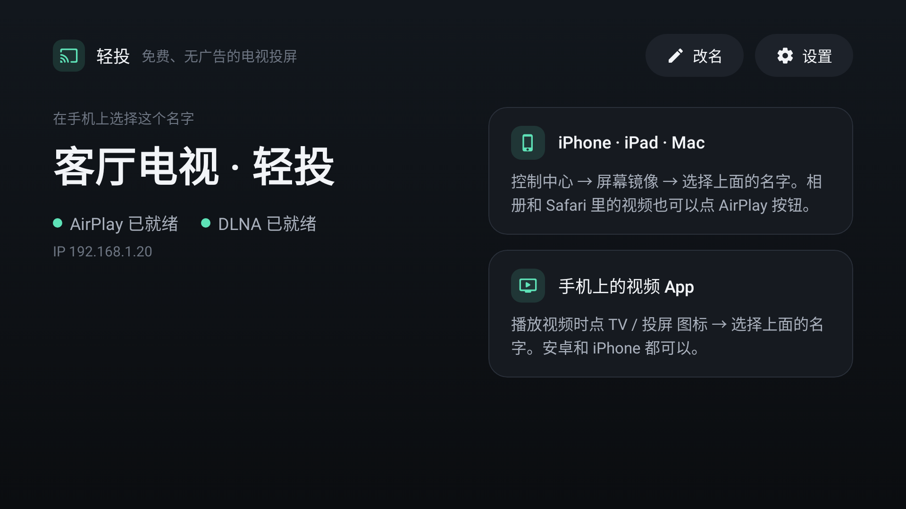
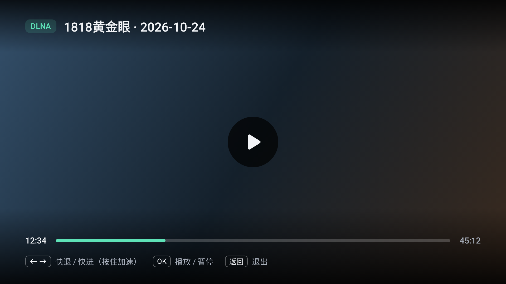
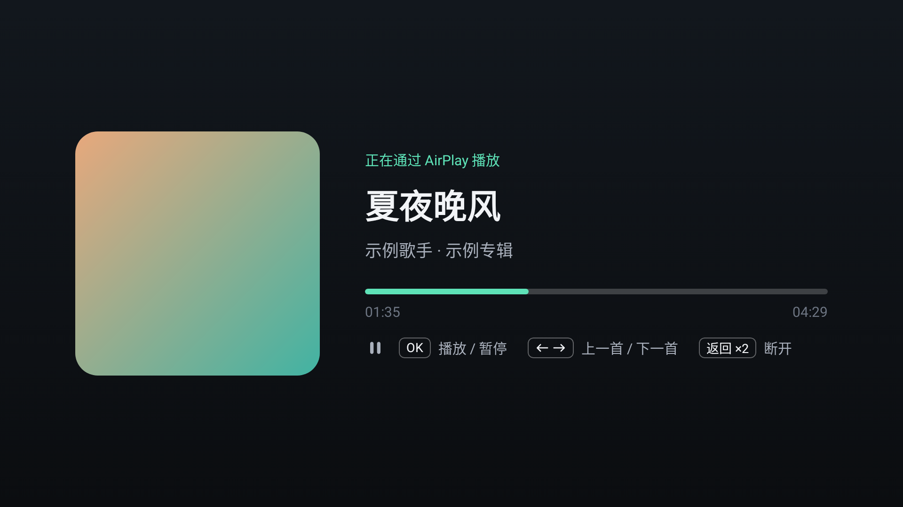
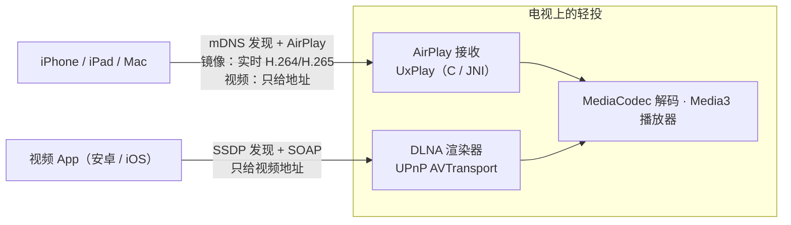

# 轻投 LiteCast

**免费、无广告、开源的电视投屏接收端。** 装在电视上以后，iPhone 的屏幕镜像、AirPlay 视频和音乐、各种视频 App 里的「TV / 投屏」按钮（DLNA）都能直接投到电视，不用登录，不限时长，也不弹会员广告。

最初是为了国行索尼 X90J 做的：这台电视自带的投屏走的是乐播，用一会儿就提示收费。轻投在大多数 Android TV / 安卓电视上都能用（Android 6.0 及以上，ARM 芯片）。

[English](README.en.md)

| 主页 | 视频投屏 | AirPlay 音乐 |
|---|---|---|
|  |  |  |

## 能投什么

| 来源 | 能不能投 | 说明 |
|---|---|---|
| iPhone / iPad / Mac **屏幕镜像** | ✅ | 控制中心 → 屏幕镜像，画面和声音一起过来 |
| iPhone 上的 **AirPlay 视频**（相册、Safari，以及支持 AirPlay 的视频 App） | ✅ | 电视自己拉流播放，手机变成遥控器 |
| **AirPlay 音乐**（Apple Music 等） | ✅ | 显示封面、歌名和进度，遥控器可切歌 |
| 视频 App 的 **TV / 投屏 按钮**（DLNA，安卓和 iPhone 都行） | ✅ 大多数 | 推过来的是视频地址，由电视播放；B 站、爱奇艺、腾讯视频、优酷等的投屏按钮都走这个，个别 App 或会员内容会限制第三方设备 |
| 有版权保护（DRM）的内容：Apple TV App、Netflix、Disney+ 等 | ❌ | 只给认证设备；镜像时也会黑屏 |
| 只走私有协议的投屏：乐播「云投屏」、华为 Cast+、小米妙播，或要求电视装官方 App 才能投的内容 | ❌ | 协议不公开 |
| 安卓手机系统自带的「无线投屏 / 屏幕镜像」（Miracast） | ❌ | 需要系统级 Wi-Fi Direct 权限，普通 App 做不到；索尼等电视一般自带「屏幕镜像」可以接 |
| Google Cast（Chromecast） | ❌ | 需要 Google 认证 |

另外：有的 App 只给会员投高清，或者对投屏单独限制清晰度，这是 App 自己的规则，接收端改变不了；投过来的链接如果带时效，过期了需要在手机上重新投。

## 安装

**用 U 盘（最简单）**

1. 到 [Releases](../../releases) 下载 `LiteCast-x.y.z.apk`，拷到 U 盘。
2. U 盘插到电视上，用电视自带的文件管理器 / 应用商店的「本地安装」打开这个 APK。
3. 如果提示不允许安装未知来源的应用，按提示给打开 APK 的那个应用开权限。
   一般在 *设置 → 设备偏好设置 → 安全性和限制 → 未知来源*，不同电视叫法略有不同。

**用 adb（电脑和电视在同一个网络）**

```bash
# 电视：设置 → 设备偏好设置 → 关于 → 连按「版本号」7 次打开开发者选项，再打开「USB 调试 / 网络调试」
adb connect 电视的IP
adb install -r LiteCast-x.y.z.apk
```

## 第一次使用

1. 打开「轻投」，主页上大字显示的就是电视的名字（默认是「电视名 · 轻投」，可以点「改名」）。两个状态点变绿就可以投了。
2. **建议**：按主页提示点「去开启」，给轻投打开 **显示在其他应用上层**。
   这样你在看别的节目时，手机一投屏，画面会直接弹出来；不开的话，需要先回到轻投再投。
   - Android TV：*设置 → 应用 → 特殊应用权限 → 显示在其他应用上层*
   - Google TV：*设置 → 隐私 → 特殊应用权限 → 显示在其他应用上层*
   - 都找不到：`adb shell appops set io.github.litecast SYSTEM_ALERT_WINDOW allow`
3. 手机连同一个 Wi-Fi：
   - **iPhone 镜像**：控制中心 → 屏幕镜像 → 选电视的名字
   - **视频 App**：播放时点 TV / 投屏 图标 → 选电视的名字

之后不用再管它：轻投在后台安静待命（只是在局域网里等手机来找它），电视重启后也会自动启动。投屏结束后播放界面会自己关掉，回到你原来看的东西。

## 遥控器

| 场景 | 按键 |
|---|---|
| 视频 | ← → 快退 / 快进（按住越按越快）· OK 播放 / 暂停 · ↑ ↓ 显示进度 · 返回：收起进度条 / 退出播放 |
| 屏幕镜像 | 连按两次返回：断开镜像 |
| 音乐 | OK 播放 / 暂停 · ← → 上一首 / 下一首 · 连按两次返回：断开 |

## 和电视自带的乐播共存

两个可以同时开着，手机列表里会出现两个名字：带「· 轻投」的是这个应用。轻投会自动避开被占用的端口，不需要先关乐播；只是乐播占着 DLNA 的发现端口时，轻投要靠定时广播让手机看到，可能要等十几秒才出现在列表里。

不想看到乐播的话，可以在 *设置 → 应用* 里找到乐播投屏，选「停用」或者关掉它的自启动（能不能停用取决于电视系统）。

## 常见问题

**手机上找不到电视**
- 手机和电视要在同一个局域网；路由器的「访客网络」「AP 隔离」，以及一些 Mesh 设置会挡住设备发现。
- iPhone 上的视频 App 第一次投屏时会问「允许查找本地网络上的设备」，要点允许（漏点了在 iPhone 设置 → 隐私与安全性 → 本地网络 里打开）。
- 手机开着 VPN 时可能看不到局域网设备。
- 打开轻投看看两个状态是不是绿的；必要时在 设置 → 接收投屏 关掉再打开。

**投屏了但电视没反应** — 看上面第 2 步，开「显示在其他应用上层」，或者打开轻投点「回到投屏」。

**视频一直转圈或提示失败** — 网络问题会自动重试 3 次；如果提示链接失效，是手机给的地址过期或被拒绝了，在手机上重新投一次。DRM 视频放不了。

**镜像卡顿** — 尽量让手机连 5 GHz Wi-Fi，电视用网线；也可以在 设置 → 高级设置 里降低分辨率或帧率。

**安全吗** — 不需要账号，不收集任何数据，没有广告。投屏协议本身没有密码（AirPlay 可以在设置里打开配对码），所以请只在自己家里的网络里使用，不要把电视的端口映射到公网。

## 工作原理



- **屏幕镜像**：手机把屏幕实时压成视频流发给电视，电视解码显示，所以手机要一直亮着。
- **推视频（AirPlay 视频 / DLNA）**：手机只把视频地址告诉电视，电视自己去下载播放，手机只当遥控器。
- 两边都只是在局域网里互相发现、互相通话，不经过任何服务器。

## 这个项目由什么组成

轻投没有从零造轮子，而是把两个开源项目的长处拼在一起，再为遥控器重新做了界面：

- **AirPlay**：[jqssun/android-airplay-server](https://github.com/jqssun/android-airplay-server)（基于 [UxPlay](https://github.com/FDH2/UxPlay)）——镜像、AirPlay 视频、音乐、配对码都来自它。本仓库保留了它的完整提交历史，改动的地方都标了 `LiteCast:` 注释，方便以后合并上游更新。
- **DLNA**：渲染器（SSDP、HTTP/SOAP、事件订阅、格式识别）移植自 [小狗便利店投屏 puppy-store-cast](https://github.com/leiz56638111-create/puppy-store-cast)，并放宽了对各家 App 不规范请求的容忍度。
- **电视端体验**：常驻接收、开机自启、投屏自动弹出等做法参考了 [sony-airplay-tv](https://github.com/Reasno/sony-airplay-tv) 和 [SonyCast-AndroidTV](https://github.com/Xecxes/SonyCast-AndroidTV)。

```
app/src/main/kotlin/io/github/jqssun/airplay/   上游 AirPlay 接收端（改动处标 LiteCast:）
app/src/main/cpp/                               UxPlay、OpenSSL、FFmpeg、libplist 与 JNI 桥
app/src/main/java/io/github/litecast/dlna/      DLNA 协议层（移植自 小狗便利店投屏）
app/src/main/kotlin/io/github/litecast/dlna/    AVTransport 状态机、DLNA 渲染器
app/src/main/kotlin/io/github/litecast/tv/      电视界面：主页、设置、播放器
app/src/test/                                   协议单元测试、socket 集成测试、界面截图
```

## 从源码构建

需要 JDK 21，以及 Android SDK（Platform 37、NDK 27.0.12077973、CMake 3.22.1；Gradle 会提示缺什么）。

```bash
git clone --recursive https://github.com/<你的用户名>/LiteCast.git
cd LiteCast
./gradlew assembleDebug          # 输出 app/build/outputs/apk/debug/app-debug.apk
./gradlew testDebugUnitTest      # 单元测试
./gradlew lintDebug              # 静态检查（上游遗留的问题记在 app/lint-baseline.xml，新问题会报错）
./gradlew testDebugUnitTest -Pscreenshots   # 重新生成 docs/screenshots 里的界面截图
```

默认打包 `arm64-v8a` 和 `armeabi-v7a`（很多电视是 64 位芯片配 32 位系统，两个都要）；加 `-PwithX86` 会多打一个 x86_64，给模拟器用。

**发布签名**：在 `local.properties` 里写上

```properties
storeFile=/绝对路径/litecast-release.jks
storePassword=...
keyAlias=litecast
keyPassword=...
```

然后 `./gradlew assembleRelease`。GitHub Actions 在推送 `v*` 标签时会自动构建并发布，需要在仓库 Settings → Secrets 里配置 `KEYSTORE_BASE64`（`base64 -w0 litecast-release.jks` 的输出）、`KEYSTORE_PASSWORD`、`KEY_ALIAS`、`KEY_PASSWORD`。**签名文件不要提交到仓库，也要备份好**：换了签名，用户就没法覆盖升级。

**合并上游更新**

```bash
git remote add upstream https://github.com/jqssun/android-airplay-server.git
git fetch upstream && git merge upstream/main
```

## 许可

[GPL-3.0](LICENSE)。各组件的版权和许可见 [THIRD_PARTY_NOTICES.md](THIRD_PARTY_NOTICES.md)。

本项目与 Apple、索尼、乐播、当贝等公司没有任何关系。AirPlay 是 Apple Inc. 的商标；DLNA、UPnP 在这里只用来说明互通的协议。
