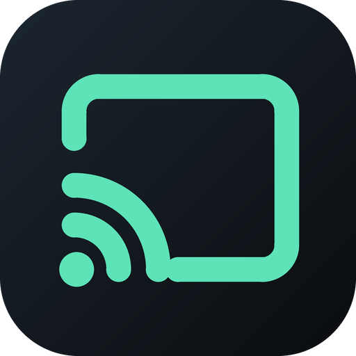
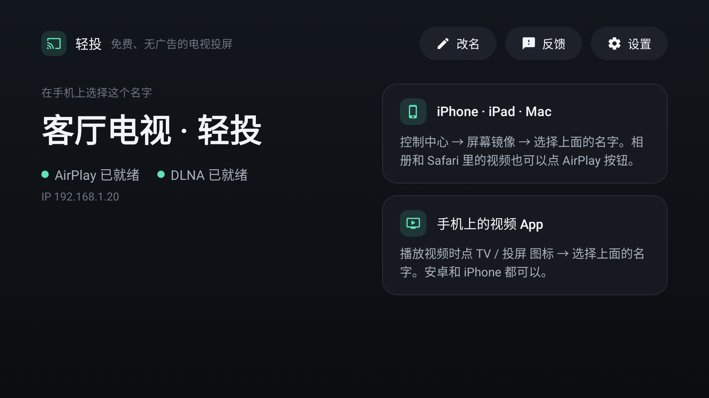
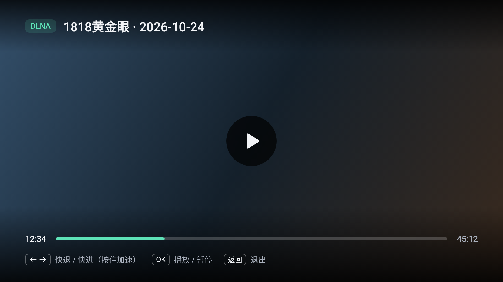
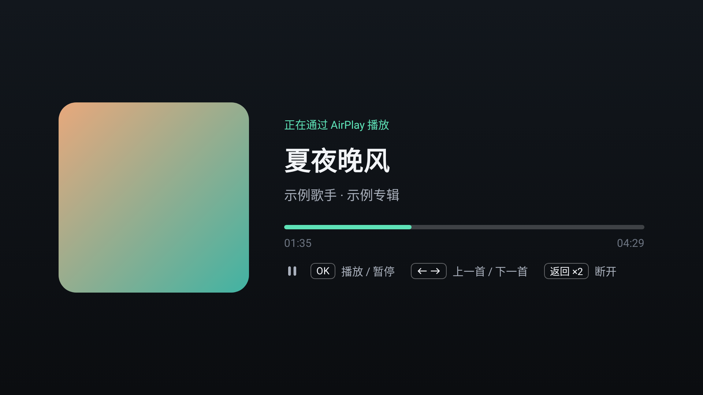
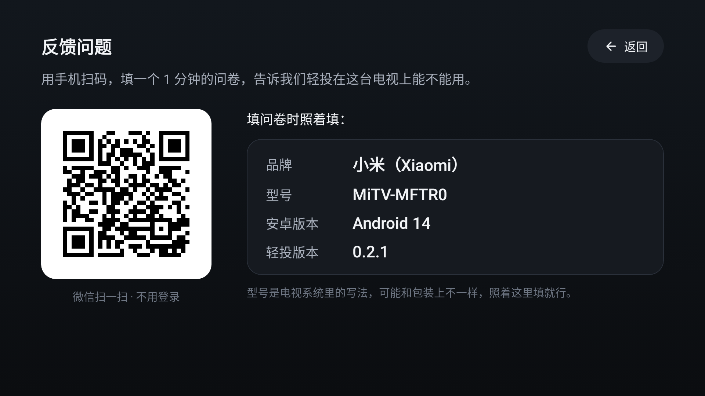
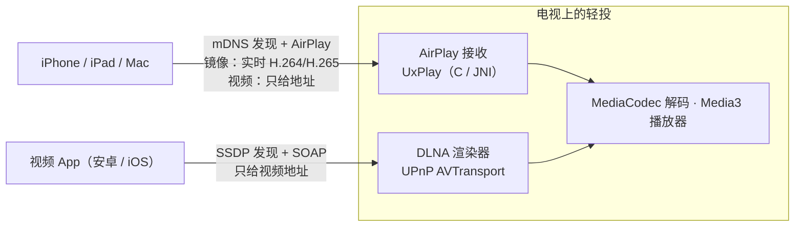

<div align="center">



# 轻投 LiteCast

**免费、没有广告的电视投屏。** 装在安卓电视上，苹果手机和安卓手机都能投过来。

[下载 APK](https://github.com/Jaqennn/LiteCast/releases/latest/download/LiteCast.apk) · [安装方法](#安装) · [恢复原样](#恢复原样) · [常见问题](#常见问题) · [English](README.en.md)

</div>

| 主页 | 视频投屏 | AirPlay 音乐 |
|---|---|---|
|  |  |  |

## 解决什么问题

- **电视自带的投屏开始收费**：国行索尼等电视预装的乐播投屏，用一会儿就弹窗要开会员。轻投最早就是为一台国行索尼 X90J 做的。
- **苹果手机投不了安卓电视**：iPhone 的屏幕镜像只认 AirPlay，大多数安卓电视不支持。
- **换一个投屏软件也躲不开**：不少第三方投屏软件要登录、有广告、限时长；有的装的时候免费，自动升级后也开始收费，每次只让投十分钟。
- **网上的土办法不长久**：卸载乐播更新、恢复旧版，不少人反馈系统一升级又变回去了。

## 轻投的特点

- 免费、没有广告，不用登录，不限时长；代码开源，谁都能查
- 不会突然冒出会员：投屏只在你家 Wi-Fi 里进行，轻投没有服务器，也没有账号
- 苹果和安卓手机都能投：AirPlay（屏幕镜像、视频、音乐）和 DLNA（视频 App 的投屏按钮）同时开着，不用切换模式
- 老电视也能用：Android 5.0 及以上的电视、盒子、投影仪
- 装一次就行：开机自动在后台待命，手机一投，画面自己弹出来，投完自己关掉
- 不碰电视原来的东西：不改系统设置，能和乐播同时存在（乐播占着端口时自动换一个，不用手动改），卸载就恢复原样
- 安装包不到 10 MB，新老电视、32 位和 64 位芯片都用这一个

## 能投什么

**苹果手机 / iPad / Mac**

| 投屏方式 | 在手机上怎么投 | 能不能投 |
|---|---|---|
| 屏幕镜像 | 控制中心 → 屏幕镜像 → 选「电视名 · 轻投」 | ✅ 画面和声音一起过来 |
| AirPlay 视频 | 相册、Safari，以及支持 AirPlay 的 App 里点 AirPlay 图标 | ✅ 电视自己播放，手机可以锁屏 |
| AirPlay 音乐 | Apple Music 等音乐 App 里点 AirPlay 图标 | ✅ 显示封面、歌名和进度 |
| 视频 App 的「TV / 投屏」按钮 | B 站、爱奇艺、腾讯视频、优酷等，播放时点投屏图标 | ✅ 大多数（DLNA） |

**安卓手机**

| 投屏方式 | 在手机上怎么投 | 能不能投 |
|---|---|---|
| 视频 App 的「TV / 投屏」按钮（DLNA） | B 站、爱奇艺、腾讯视频、优酷、芒果 TV、各类直播 App 等，播放时点投屏图标 → 选「电视名 · 轻投」 | ✅ 大多数 |
| 系统自带的「无线投屏 / 屏幕镜像」（Miracast） | 下拉菜单里的投屏开关 | ❌ 要系统级权限，普通 App 做不到；不少电视自带「屏幕镜像」可以接 |
| 华为 Cast+、小米妙播等手机厂商自己的投屏 | — | ❌ 协议不公开 |

**投不了的**

- 有版权保护（DRM）的内容：Netflix、Disney+、Apple TV App 等，镜像时也会黑屏
- 乐播「云投屏」、Google Cast（Chromecast），以及要求电视装官方 App 才能投的内容

清晰度由 App 决定：DLNA 只是把视频地址交给电视，比如 B 站给第三方设备最高 720P，抖音最高 1080P，会员内容有的只给自家设备投高清。这是 App 的规则，接收端改变不了。

## 支持哪些电视

- **系统**：Android 5.0 及以上。各品牌的安卓电视、Android TV / Google TV、电视盒子、投影仪都可以
- **常见品牌**：索尼的 Android TV / Google TV（X90J、A90J、X90L 等）；TCL、小米、创维、夏普等电视，当贝、极米等投影仪，小米盒子等电视盒子，系统大多是安卓改的，能装第三方应用就能装轻投
- **芯片**：ARM（市面上的电视几乎都是）
- **不支持**：Android 4.4 及更老的系统；不是安卓的系统，比如三星 Tizen、LG webOS；连第三方应用都装不了的老电视。华为、荣耀智慧屏还没人试过
- **怎么判断**：电视的 设置 → 关于 里能看到「Android 版本」（一般在「版本信息」里），或者电视能装当贝市场这类第三方应用，基本就能用

已实测的电视：

| 电视 | 系统 | 情况 |
|---|---|---|
| 索尼 X90J 国行 | Android 10 | ✅ 作者自用：屏幕镜像、AirPlay 视频和音乐、视频 App 投屏都正常 |

Android 5.0–5.1 还没有真机实测。你的电视能用或不能用，都欢迎 [填问卷告诉我们](https://wj.qq.com/s2/28601337/57hw/)（不用注册，也可以 [在 GitHub 上提](https://github.com/Jaqennn/LiteCast/issues/new?template=device.yml)），会整理进这张表。

## 下载

最简单：点 [下载 LiteCast.apk](https://github.com/Jaqennn/LiteCast/releases/latest/download/LiteCast.apk)，这就是要装到电视上的文件。

也可以打开 [发布页](https://github.com/Jaqennn/LiteCast/releases/latest)，在版本说明下面的「Assets」里点 **LiteCast.apk**。旁边的「Source code (zip)」「Source code (tar.gz)」是源代码，不用下载。

GitHub 打不开或者下载很慢：

- 先换成手机流量或者别的 Wi-Fi 再试，很多时候就好了
- 用国内备用下载（蓝奏云）：[https://wwary.lanzoub.com/b01i5zvujg](https://wwary.lanzoub.com/b01i5zvujg)，提取码 `47il`，打开后点 LiteCast.apk 下载。里面是从发布页原样传上去的同一个文件，新版本以 GitHub 为准；想核对的话，SHA-256 写在发布页说明的末尾
- 让 AI 帮你装（见下面方法二），它会换加速地址下载，并核对文件和官方的一样

## 安装

三种方法选一种。

### 方法一：U 盘（最简单）

不用电脑，不用开发者模式，也不用写代码。

1. 把 LiteCast.apk 拷到 U 盘，插到电视上。
2. 用电视自带的文件管理器（有的叫「媒体中心」「本地播放」「我的文件」）找到 LiteCast.apk，按确认键打开。索尼国行更简单：插上 U 盘后打开电视里的「应用助手」，它会直接列出 U 盘里的「轻投」，点它再点「安装」（作者的 X90J 就是这样装的；那句「索尼无法保证被安装应用质量」是装任何第三方应用都会显示的提示）。别的电视看不到这个文件的话，是文件管理器把安装包藏起来了：换用电视上的「应用管家」「软件管家」这类自带应用打开 U 盘试试。
3. 如果提示不允许安装未知来源的应用，按提示去设置里允许你用来打开 APK 的那个应用安装应用，再打开一次。不同电视位置不一样，常见的是：
   - 索尼和其他 Android TV：设置 → 设备偏好设置 → 安全性和限制 → 未知来源
   - 小米：设置 → 账号与安全 → 安装未知来源的应用
4. 装好后，电视的应用列表里会出现「轻投」。

### 方法二：让 AI 帮你装

会用能在电脑上运行命令的 AI（Claude Code、Codex、豆包电脑版、千问电脑版、Trae、WorkBuddy 等）的话，把下面这段发给它，它会一步步装好并验收：

```text
请帮我把开源投屏软件「轻投 LiteCast」装到我的电视上。
电视 IP：<电视IP>

安装说明在这里：https://github.com/Jaqennn/LiteCast/blob/main/docs/agent.md
（打不开时用 https://raw.githubusercontent.com/Jaqennn/LiteCast/main/docs/agent.md ）

请先完整读完安装说明再动手，然后在我的电脑上亲自运行命令，不要只把步骤告诉我。需要我在电视上操作时提醒我。
最后按说明里的「验收」，把命令的原始输出原样贴给我。
```

电脑和电视要连同一个网络，电视要打开 ADB 调试（见下面方法三的表，AI 也会告诉你）。电视的 IP 在 设置 → 网络 里能看到。手机上的 AI 聊天只会把步骤告诉你，不会替你执行。

### 方法三：电脑上用 adb

先在电视上打开 ADB 调试：

| 电视 | 怎么打开 ADB |
|---|---|
| 索尼、海信、其他 Android TV / Google TV | 设置 → 设备偏好设置 → 关于 → 连续按「内部版本号」7 次，再到 开发者选项 打开「USB 调试」（也可能叫「网络调试」） |
| 小米 / Redmi | 设置 → 关于 → 连续按「产品型号」，直到提示进入开发者模式；再到 设置 → 账号与安全，打开「ADB 调试」 |
| TCL / 雷鸟 | 设置 → 关于 → 本机信息，快速依次按遥控器「上、下、左、右」，在底部出现的「更多」里打开 ADB |

各品牌的方法参考了 [Aerial](https://github.com/pengchujin/aerial-tv) 项目整理的用户实测说明。只有「无线调试」的 Android 11+ 电视（比如索尼 BRAVIA 的 Android 14）要先配对，见 [docs/agent.md](docs/agent.md) 第 2 步。

然后在电脑上运行：

```bash
adb connect 电视的IP:5555
adb install -r LiteCast.apk
adb shell appops set io.github.litecast SYSTEM_ALERT_WINDOW allow
adb shell am start -n io.github.litecast/io.github.litecast.tv.HomeActivity
```

第三条让投屏画面能盖在别的节目上，Android 5.x 不需要，报错可以忽略。装不上时按 [docs/agent.md](docs/agent.md) 里「第 5 步」的说明处理。

### 以后升级

有新版本时，下载新的 LiteCast.apk，按上面同样的方法装一次就行，会直接覆盖旧版，设置都保留。

如果提示「应用未安装」或者签名不一致，多半是电视上还留着 0.2.0 以前的测试版（用的是另一把签名钥匙）：先按「恢复原样」卸载旧的，再装新的。

## 第一次使用

1. 在电视的应用列表里打开「轻投」。主页上的大字就是电视在手机上显示的名字（默认是「电视名 · 轻投」，可以点「改名」）。两个状态点变绿就可以投了。
2. 建议按主页提示点「去开启」，给轻投打开「显示在其他应用上层」。这样你在看别的节目时，手机一投屏，画面会直接弹出来；不开的话，要先回到轻投再投。
   - Android TV：设置 → 应用 → 特殊应用权限 → 显示在其他应用上层
   - Google TV：设置 → 隐私 → 特殊应用权限 → 显示在其他应用上层
   - 都找不到：`adb shell appops set io.github.litecast SYSTEM_ALERT_WINDOW allow`
   - Android 5.x 没有这个开关，也不需要
3. 手机和电视连同一个 Wi-Fi，按上面「能投什么」里的方法投。

之后就不用管它了：轻投在后台安静待命（只是在局域网里等手机来找它），电视重启后也会自己启动。投屏结束后播放界面会自己关掉，回到你原来看的东西。

## 遥控器

| 场景 | 按键 |
|---|---|
| 视频 | ← → 快退 / 快进（按住越按越快）· OK 播放 / 暂停 · ↑ ↓ 显示进度 · 返回：收起进度条 / 退出播放 |
| 屏幕镜像 | 连按两次返回：断开镜像 |
| 音乐 | OK 播放 / 暂停 · ← → 上一首 / 下一首 · 连按两次返回：断开 |

## 和电视自带的乐播共存

两个可以同时开着，手机列表里会出现两个名字：带「· 轻投」的是轻投。轻投会自动避开被占用的端口，不需要先关乐播；乐播占着 DLNA 的发现端口时，手机列表可能要等几秒才出现轻投。

不想看到乐播的话，可以在 设置 → 应用 里找到乐播投屏，选「停用」或者关掉它的自启动（能不能停用取决于电视系统）。

## 恢复原样

轻投不改电视的系统设置，也不停用任何应用，所以卸载就是完全还原：

- 电视上：设置 → 应用 →「查看全部应用」（有的叫「所有应用」）→ 轻投 → 卸载（有的电视在应用列表里长按「轻投」也能卸载）
- 电脑上：`adb uninstall io.github.litecast`

如果你按上一节停用过乐播，想恢复：设置 → 应用 →（显示系统应用）→ 乐播投屏 → 启用。

## 和其他办法比

| 办法 | 好处 | 麻烦 |
|---|---|---|
| 乐播开会员 | 不用折腾 | 要一直交钱 |
| 卸载乐播更新、恢复旧版 | 不用装别的 | 不少人反馈系统一升级又变回去 |
| 其他免费投屏软件 | 装上就能用 | 有的要登录、有广告、限时长，也有用着用着开始收费的 |
| 买电视盒子、Apple TV | 稳定 | 要另外花钱，多占一个 HDMI 口 |
| HDMI 线接电脑或手机 | 画质最好，没有延迟 | 要拉线，不方便 |
| 轻投 | 免费开源，苹果、安卓都能投，和乐播共存 | 安卓手机整屏镜像不行；要会装 APK |

## 常见问题

**我的电视能装吗？**
安卓系统、Android 5.0 及以上就能装，见上面「支持哪些电视」。装不上时把提示拍下来 [反馈](https://github.com/Jaqennn/LiteCast/issues/new?template=device.yml)。

**发布页上那么多文件，下载哪个？**
只下载 LiteCast.apk。「Source code」是源代码，给开发者用的。

**索尼电视投屏提示收费（乐播）怎么办？**
装上轻投，投屏时选带「· 轻投」的那个名字就行，不登录、不限时长、没有会员弹窗。乐播可以留着不管，两个能同时开着；也不用像有的教程那样改端口，乐播占着端口时，轻投会自动换一个。

**iPhone、iPad 怎么投屏到安卓电视 / 索尼电视？**
电视上打开过一次轻投后，iPhone 或 iPad 和电视连同一个 Wi-Fi：整个屏幕用「控制中心 → 屏幕镜像」；看视频用 App 里的 AirPlay 或投屏按钮，这样手机可以锁屏。

**和当贝投屏、乐播投屏、电视自带投屏有什么区别？**
轻投完全免费开源，没有广告和会员，同时支持 AirPlay（苹果）和 DLNA（各家视频 App 的投屏按钮），不用切换模式。它做不到私有协议的投屏（比如乐播云投屏、华为 Cast+）和有 DRM 的内容，见上面「能投什么」。

**以后会不会也收费？**
轻投没有服务器，也没有账号，投屏只在你家网络里进行，没有要收费的环节。代码以 GPL-3.0 开源，就算以后没人维护，代码也在，谁都可以接着改。

**每次投屏都要先打开轻投吗？**
不用。电视开机后轻投自己在后台待命；按「第一次使用」第 2 步打开「显示在其他应用上层」后，正在看别的节目时手机一投，画面也会自己弹出来。

**电视待机（黑屏）的时候能投吗？**
现在还不行，要先把电视打开。

**安卓手机下拉菜单里的「无线投屏」，还有华为、小米、三星手机自带的投屏，为什么找不到轻投？**
这些是 Miracast 或者手机厂商自己的协议，要电视系统级的权限，普通 App 接不了。安卓手机请用视频 App 里的「投屏 / TV」按钮。

**要搭开发环境、写代码吗？**
不用。下载一个 LiteCast.apk 文件，用 U 盘装到电视上就行，见「安装」。

**手机上找不到电视**
- 手机和电视要在同一个局域网；路由器的「访客网络」「AP 隔离」，以及一些 Mesh 设置会挡住设备发现。
- iPhone 上的视频 App 第一次投屏时会问「允许查找本地网络上的设备」，要点允许（漏点了在 iPhone 设置 → 隐私与安全性 → 本地网络 里打开）。
- 手机开着 VPN 时可能看不到局域网设备。
- 打开轻投看看两个状态是不是绿的；必要时在 设置 → 接收投屏 关掉再打开。

**投屏了但电视没反应** — 看「第一次使用」第 2 步，开「显示在其他应用上层」，或者打开轻投点「回到投屏」。

**投屏清晰度不高** — 清晰度是 App 决定的（见「能投什么」最后一段）。B 站更高的清晰度要用它的「官方投屏」（接收端是电视上的「云视听小电视」）。播放时按遥控器 ↑，左上角会显示实际清晰度（如「1080P」「4K」）。

**画质会压缩吗？** — 屏幕镜像是把手机屏幕实时压成视频再发过来，比 HDMI 线直连糊一点；视频 App 投屏是电视直接播放原视频，清晰度由 App 决定。

**支持 4K、HDR 吗？** — 视频 App 投屏时，App 给的是 4K、电视也能解码，放出来就是 4K；HDR 要看视频本身和电视支不支持。屏幕镜像建议用 1080P。

**能投屏打游戏吗？** — 屏幕镜像有一点延迟，看视频、看照片没问题，节奏快的游戏不合适。最高帧率默认 60，在 设置 → 高级设置 里能改。

**能倍速播放吗？竖屏视频能铺满吗？** — 倍速还不支持。竖屏视频放在横着的电视上，两边会留黑边，铺不满。

**某个 App 投过来一会儿就断，或者列表里没有轻投** — 有的 App 只认自家的电视端，或者限制了第三方接收端。可以改用屏幕镜像，也欢迎 [反馈](#反馈) 是哪个 App。

**油管一直加载，或提示连不上视频服务器** — 用 AirPlay 推油管视频时，视频是电视直接从 YouTube 服务器下载的，手机只负责遥控。电视所在的网络访问不了 YouTube 就放不了：可以改用屏幕镜像，或者让电视的网络也能访问（在路由器上统一处理，或者在电视的 Wi-Fi 设置里填一个局域网里的代理；轻投会让本机和局域网地址绕过代理，不影响投屏）。

**视频一直转圈或提示失败** — 网络问题会自动重试 3 次；如果提示链接失效，是手机给的地址过期或被拒绝了，在手机上重新投一次。DRM 视频放不了。

**镜像卡顿** — 尽量让手机连 5 GHz Wi-Fi，电视用网线；也可以在 设置 → 高级设置 里降低分辨率或帧率。老电视的芯片解码能力弱，镜像时建议用 1080P。

**安全吗** — 不需要账号，不收集任何数据，没有广告。申请的权限只有这些：网络和局域网发现（让手机找到电视）、开机启动、显示在其他应用上层（投屏时弹出画面）、后台待命用的前台服务和通知、投屏时保持亮屏；不要存储、相机、麦克风、通讯录、位置权限。投屏协议本身没有密码（AirPlay 可以在设置里打开配对码），所以请只在自己家里的网络里使用，不要把电视的端口映射到公网。

## 反馈

装了轻投的话最方便：主页右上角点「反馈」，电视上会显示问卷二维码，旁边写好了这台电视的品牌、型号和安卓版本，手机扫码照着填就行。



没装或者装不上：用微信扫下面的二维码，或者打开 [腾讯问卷](https://wj.qq.com/s2/28601337/57hw/)，1 分钟就能填完，不用注册，国内网络直接能打开。


有 GitHub 账号的话，也可以在这里提：

- [机型反馈](https://github.com/Jaqennn/LiteCast/issues/new?template=device.yml)：你的电视能用还是不能用
- [问题反馈](https://github.com/Jaqennn/LiteCast/issues/new?template=bug.yml)：投屏失败、卡顿、找不到电视、闪退等

至少写上电视品牌就行；知道型号和安卓版本更好，一般在电视的 设置 → 关于 里，也可以看电视背面的标签。

## 工作原理



- **屏幕镜像**：手机把屏幕实时压成视频流发给电视，电视解码显示，所以手机要一直亮着。
- **推视频（AirPlay 视频 / DLNA）**：手机只把视频地址告诉电视，电视自己去下载播放，手机只当遥控器。
- 两边都只是在局域网里互相发现、互相通话，不经过任何服务器。

## 这个项目由什么组成

轻投没有从零造轮子，而是把两个开源项目的长处拼在一起，再为遥控器重新做了界面：

- **AirPlay**：[jqssun/android-airplay-server](https://github.com/jqssun/android-airplay-server)（基于 [UxPlay](https://github.com/FDH2/UxPlay)）——镜像、AirPlay 视频、音乐、配对码都来自它。本仓库保留了它的完整提交历史，改动的地方都标了 `LiteCast:` 注释，方便以后合并上游更新。
- **DLNA**：渲染器（SSDP、HTTP/SOAP、事件订阅、格式识别）移植自 [小狗便利店投屏 puppy-store-cast](https://github.com/leiz56638111-create/puppy-store-cast)，并放宽了对各家 App 不规范请求的容忍度。
- **电视端体验**：常驻接收、开机自启、投屏自动弹出等做法参考了 [sony-airplay-tv](https://github.com/Reasno/sony-airplay-tv) 和 [SonyCast-AndroidTV](https://github.com/Xecxes/SonyCast-AndroidTV)；安装说明和给 AI 的安装流程参考了 [Aerial](https://github.com/pengchujin/aerial-tv)。

```
app/src/main/kotlin/io/github/jqssun/airplay/   上游 AirPlay 接收端（改动处标 LiteCast:）
app/src/main/cpp/                               UxPlay、OpenSSL、FFmpeg、libplist 与 JNI 桥
app/src/main/java/io/github/litecast/dlna/      DLNA 协议层（移植自 小狗便利店投屏）
app/src/main/kotlin/io/github/litecast/dlna/    AVTransport 状态机、DLNA 渲染器
app/src/main/kotlin/io/github/litecast/tv/      电视界面：主页、设置、播放器
app/src/test/                                   协议单元测试、socket 集成测试、界面截图
docs/agent.md                                   给 AI Agent 的安装说明
```

## 从源码构建

需要 JDK 21，以及 Android SDK（Platform 37、NDK 27.0.12077973、CMake 3.22.1；Gradle 会提示缺什么）。

```bash
git clone --recursive https://github.com/Jaqennn/LiteCast.git
cd LiteCast
./gradlew assembleDebug          # 输出 app/build/outputs/apk/debug/app-debug.apk
./gradlew testDebugUnitTest      # 单元测试
./gradlew lintDebug              # 静态检查（上游遗留的问题记在 app/lint-baseline.xml，新问题会报错）
./gradlew testDebugUnitTest -Pscreenshots   # 重新生成 docs/screenshots 里的界面截图
```

默认打包 `arm64-v8a` 和 `armeabi-v7a`（很多电视是 64 位芯片配 32 位系统，两个都要）；加 `-PwithX86` 会多打一个 x86_64，给模拟器用。

为了支持 Android 5.x，Compose 停在 1.9（BOM 2025.11.01）、Media3 停在 1.8：这两个库更新的版本要求 Android 6.0。升级它们之前先确认 minSdk 还是 21。

**发布新版本**：签名钥匙存在仓库的加密 Secrets 里（`KEYSTORE_BASE64` 是 `base64 -w0 litecast-release.jks` 的输出，另外三个是 `KEYSTORE_PASSWORD`、`KEY_ALIAS`、`KEY_PASSWORD`）。改好 `app/build.gradle.kts` 里的 `versionCode` 和 `versionName`，把发布说明写进 `docs/release-notes/<版本号>.md`，推到 main，然后在 Actions → Release → Run workflow 运行一次：它会跑测试、签名打包、核对证书指纹，再创建 `v<版本号>` 发布页，附上 `LiteCast.apk` 和它的 SHA-256。勾选 dry run 只打包检查、不发布。每个版本都叫 `LiteCast.apk`，README 里的下载链接才会一直指向最新版。发布后，把新的 LiteCast.apk 传到蓝奏云文件夹「轻投LiteCast」，删掉旧的，国内备用下载才是最新的。

在自己电脑上打包：在 `local.properties` 里写上

```properties
storeFile=/绝对路径/litecast-release.jks
storePassword=...
keyAlias=litecast
keyPassword=...
```

然后 `./gradlew assembleRelease`。GitHub Actions 每次推送都会编译和测试，这一步用不到签名钥匙。**签名文件不要提交到仓库，也要备份好**：换了签名，用户就没法覆盖升级。

**合并上游更新**

```bash
git remote add upstream https://github.com/jqssun/android-airplay-server.git
git fetch upstream && git merge upstream/main
```

## 关于这个项目

我把自己日常碰到的需求记下来，再用 AI（Claude）把它们做成软件，轻投是其中一个：起因是家里的索尼电视投屏开始收费。代码、测试和界面都是 AI 在开源项目的基础上完成的，我负责提需求和在自己的电视上实测。

同系列的其他项目：

- [拾影 ShiYing](https://github.com/Jaqennn/ShiYing)：免费开源的 Windows 视频下载器，支持 YouTube、B站、X、抖音无水印下载，带 AI 中文字幕

## 许可

[GPL-3.0](LICENSE)。各组件的版权和许可见 [THIRD_PARTY_NOTICES.md](THIRD_PARTY_NOTICES.md)。

本项目与 Apple、索尼、乐播、当贝等公司没有任何关系。AirPlay 是 Apple Inc. 的商标；DLNA、UPnP 在这里只用来说明互通的协议。
